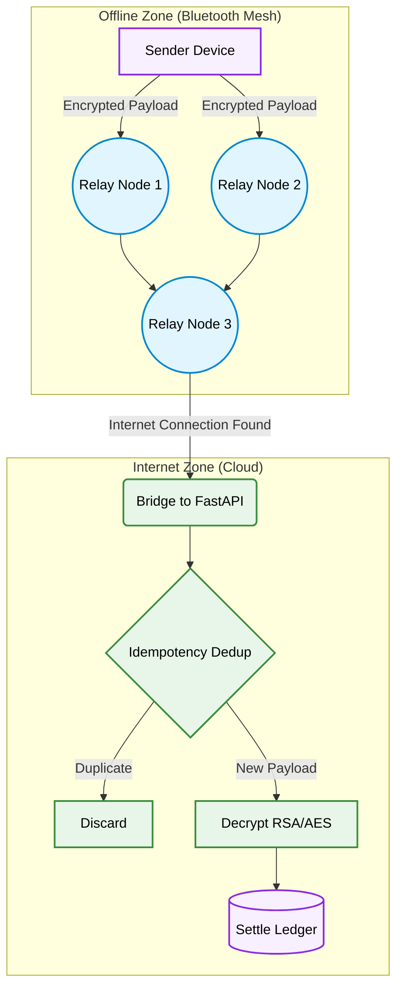

# UPI Mesh

An offline-first payment backend that settles UPI-style transactions without internet connectivity using hybrid RSA/AES encryption, a simulated Bluetooth mesh, and idempotent settlement.

> **Live Deployments:**
> * **Interactive API Documentation:** [upi-mesh.duckdns.org/docs](https://upi-mesh.duckdns.org/docs)
> * **Mesh Simulator Dashboard:** [upi-mesh.duckdns.org](https://upi-mesh.duckdns.org/)

---

## Overview

UPI Mesh solves the critical last-mile offline connectivity problem in digital payment rails. When users are offline (rural regions, crowded transit, disasters, or connectivity blackouts), transactions are signed, encrypted with RSA-2048 + AES-256-GCM hybrid encryption, and hopped peer-to-peer across adjacent devices over a simulated Bluetooth mesh. 

As soon as any intermediate device reconnects to cellular data or Wi-Fi, it securely bridges queued payloads to the FastAPI backend, where ciphertext hashing, strict freshness checks, and optimistic database locking guarantee exactly-once settlement.

---

## Architecture Overview



---

## Features

| Feature | Description |
| ------- | ----------- |
| **Hybrid Cryptography** | Sender devices encrypt transaction payloads via RSA-2048 (OAEP/SHA-256) combined with ephemeral AES-256-GCM symmetric keys |
| **Peer-to-Peer Mesh Gossip** | Simulates decentralized Bluetooth multi-hop forwarding with configurable Time-To-Live (TTL) decrements |
| **Opportunistic Ingestion** | Internet-connected bridge nodes automatically ingest gathered payloads to backend APIs without possessing decryption rights |
| **Ciphertext-Based Idempotency** | Uses SHA-256 digests of the raw ciphertext (rather than spoofable packet IDs) to prevent double-spending across multi-path relays |
| **Replay & Freshness Windows** | Rejects expired transaction signatures outright, preventing delayed replay injection attacks |
| **Optimistic Lock Settlement** | Atomically executes account balance transfers using SQLAlchemy optimistic locking and version columns |
| **Interactive Operations UI** | Live browser dashboard for initiating transfers, triggering gossip rounds, and observing real-time ledger settlement |

---

## Technology Stack

| Component | Technology |
| --------- | ---------- |
| Backend API | Python 3.10+, FastAPI, Uvicorn |
| Database & ORM | SQLite, SQLAlchemy ORM, Pydantic |
| Cryptography | `cryptography` (RSA-OAEP, AES-256-GCM, SHA-256) |
| Frontend | HTML5, CSS3, JavaScript, Jinja2 Templates |
| Testing & CI | pytest, ruff, GitHub Actions CI |
| Containerization | Docker, Docker Compose |

---

## Project Structure

```
UPI-Mesh/
├── app/
│   ├── main.py                     # FastAPI application routes and startup handlers
│   ├── models.py                   # SQLAlchemy ORM models (Accounts, Transactions)
│   ├── schemas.py                  # Pydantic request and response schemas
│   ├── database.py                 # SQLite engine and session factory
│   ├── crypto_service.py           # RSA-OAEP + AES-GCM hybrid encryption engine
│   ├── idempotency_service.py      # Thread-safe deduplication cache with TTL expiration
│   ├── settlement_service.py       # Atomic balance transfers with optimistic concurrency
│   ├── mesh_simulator_service.py   # Multi-device gossip network simulator
│   ├── virtual_device.py           # Simulated device node representation
│   ├── bridge_ingestion_service.py # Decrypt, deduplicate, verify freshness, and settle
│   ├── demo_service.py             # Seed demo bank accounts and sample transfers
│   └── templates/dashboard.html    # Interactive simulator and live ledger dashboard
├── tests/                          # Automated test suite (28 test scenarios)
├── docker-compose.yml              # Multi-container orchestration
├── Dockerfile                      # Application container specification
├── requirements.txt                # Production dependencies
├── ruff.toml                       # Linting and style rules
└── README.md
```

---

## Setup and Installation

### Prerequisites

- Python 3.10+
- pip package manager (or Docker)

### 1. Clone the repository

```bash
git clone https://github.com/Shashank17singh/UPI-Mesh.git
cd UPI-Mesh
```

### 2. Install dependencies

```bash
pip install -r requirements.txt
```

### 3. Start the application server

```bash
uvicorn app.main:app --reload --port 8080
```

### 4. Access the mesh simulator

Navigate to `http://localhost:8080` in your browser. Compose demo payments between accounts, execute gossip exchanges, and flush bridge nodes to observe real-time atomic ledger updates.

---

## API Reference

| Method | Endpoint | Description |
| ------ | -------- | ----------- |
| `GET` | `/api/server-key` | Retrieve the central settlement server's RSA public key |
| `POST` | `/api/demo/send` | Simulate a sender creating and broadcasting an encrypted packet |
| `GET` | `/api/mesh/state` | Query current packet buffers across all virtual devices |
| `POST` | `/api/mesh/gossip` | Trigger a round of peer-to-peer packet gossip |
| `POST` | `/api/mesh/flush` | Force bridge nodes to upload held packets in parallel |
| `POST` | `/api/mesh/reset` | Clear mesh buffers and reset idempotency records |
| `POST` | `/api/bridge/ingest` | Production ingestion endpoint accepting bridged encrypted payloads |
| `GET` | `/api/accounts` | List active test accounts and current balances |
| `GET` | `/api/transactions` | Query recent settled and rejected transactions |

### Example Payment Request

```bash
curl -X POST http://localhost:8080/api/demo/send \
  -H "Content-Type: application/json" \
  -d '{"sender_vpa":"alice@demo","receiver_vpa":"bob@demo","amount":500,"pin":"1234","ttl":5,"start_device":"phone-alice"}'
```

---

## Running the Tests

Execute the comprehensive test suite covering cryptographic verification, concurrency, and settlement invariants:

```bash
pip install -r requirements-dev.txt
pytest -v
```

Run static code analysis and linting:

```bash
ruff check .
```

---

## Deployment

The application is fully containerized using Docker:

```bash
docker-compose up -d --build
```

Live deployments:
- **API Documentation:** [upi-mesh.duckdns.org/docs](https://upi-mesh.duckdns.org/docs)
- **Mesh Simulator:** [upi-mesh.duckdns.org](https://upi-mesh.duckdns.org/)

---

## Operational Considerations & Limitations

- **Hardware Transport Layer**: In current evaluation environments, device proximity is simulated across distributed network topologies; mobile edge deployment pairs via physical Bluetooth Low Energy (BLE) GATT peripherals and Wi-Fi Direct.
- **Offline Ledger Reconciliation**: Offline transaction records utilize cryptographically signed proof chains reconciled upon network reconnection; hardware security modules (Secure Enclave / StrongBox) are recommended for hardware-enforced double-spend prevention.

---

## License

This project is licensed under the MIT License. See [LICENSE](LICENSE) for details.
